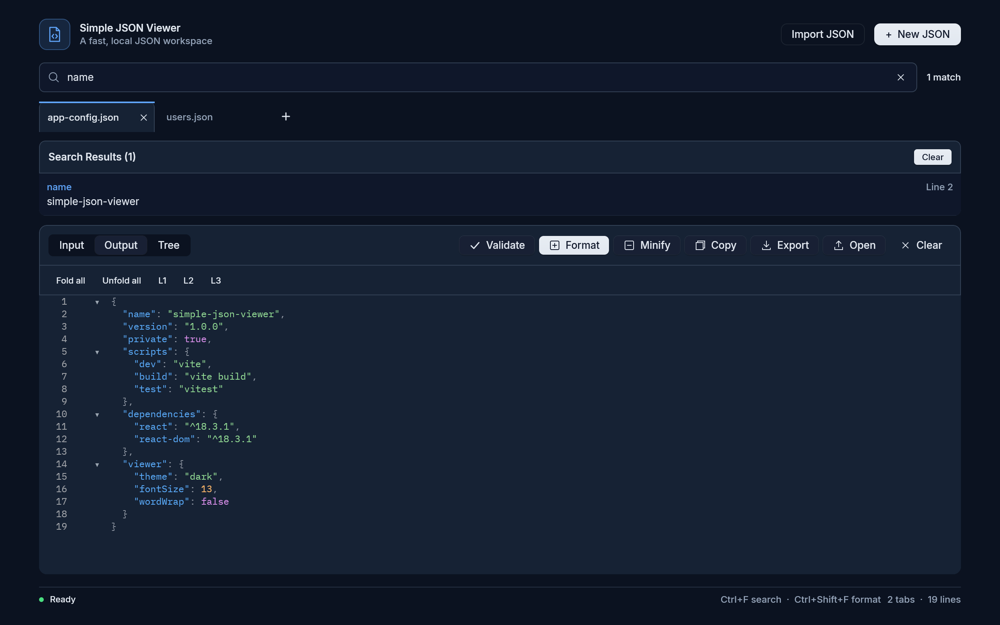

# JSON Viewer

A native desktop app for viewing, formatting, and searching JSON, built in Rust
with [Rune](https://github.com/anomalyco/rune), a GPU-rendered UI framework.
Ported from the original Electron + React app; dark theme by default.



## Features

- Multiple document tabs, persisted across restarts
- Format (pretty-print) and minify JSON on background worker threads, rewriting Input in place as one undo step
- Full-text search with a results panel; hits jump to lines in the formatted document
- Open files via dialog or drag-and-drop, export to file, copy to clipboard
- Virtualized read-only view: only visible lines are built, so large documents stay responsive
- Cross-platform: Linux, macOS, Windows

## Requirements

- **Rust 1.99.1** — pinned by `rust-toolchain.toml`; rustup installs/selects it automatically.
- **Linux build dependencies** — Rune links `libxkbcommon` and `libwayland-client`:
  - Debian/Ubuntu: `sudo apt-get install libxkbcommon-dev libwayland-dev`
  - Fedora: `sudo dnf install libxkbcommon-devel wayland-devel`
  - Arch: `sudo pacman -S libxkbcommon wayland`
- **Linux runtime (windowed)** — the XKB X11 library:
  `libxkbcommon-x11-0` (Debian/Ubuntu), `libxkbcommon-x11` (Fedora/Arch).
  Without it the window panics at startup with `Library libxkbcommon-x11.so could not be loaded`.
- **Vulkan driver** — rendering uses wgpu/Vulkan. Without a physical GPU, install a
  software driver (lavapipe): `mesa-vulkan-drivers` (Debian/Ubuntu, Fedora) or
  `vulkan-swrast` (Arch), then run with
  `VK_ICD_FILENAMES=/usr/share/vulkan/icd.d/lvp_icd.json`.
- File dialogs use `xdg-desktop-portal` over D-Bus (no GTK required).
- Headless rendering needs no display server, only a working Vulkan backend.
- macOS and Windows need no extra system packages.

## Build and run

```sh
cargo run --release -p json-viewer
```

The first build compiles the full Rune dependency tree and takes a while;
incremental builds are fast. For a debug build: `cargo run -p json-viewer`.

## Headless snapshots

Render offscreen to a PNG and dump the element tree (debug builds; release
builds need Rune's `tooling` feature for `--snap`/`--tree`):

```sh
cargo run -p json-viewer -- --snap target/headless/app.png --tree target/headless/tree.json
```

The crate's own headless mode (works in debug and release):

```sh
cargo run -p json-viewer -- --headless target/headless
# -> target/headless/placeholder.png and placeholder-tree.json
```

## Tests

```sh
cargo test                              # unit + integration tests
cargo test -p json-viewer --test smoke  # headless PNG smoke test
cargo clippy --all-targets
```

The smoke test writes `target/headless/smoke.png` and `smoke-tree.json` and
asserts the rendered tree contains the app header.

## Wayland

winit 0.30 (the revision Rune vendors) never reports file drags on native
Wayland. The default launch stays on native Wayland: fractional scaling and
IME are better there. Open still works. Drag-and-drop needs the X11 backend,
which on a Wayland session is XWayland (XDND works).

This winit has no `WINIT_UNIX_BACKEND` variable, and Rune builds the event
loop itself (it does not call `with_x11`). `--x11` and
`JSON_VIEWER_BACKEND=x11` clear `WAYLAND_DISPLAY` and `WAYLAND_SOCKET` before
the loop starts, leaving `DISPLAY` set, so winit falls back to X11. macOS and
Windows ignore both. `--x11` wins over the environment variable. `auto` (the
default) and an omitted variable do not change the environment. An unknown
`JSON_VIEWER_BACKEND` value exits with an error. A stderr line starting with
`json-viewer: window backend x11` confirms the opt-in.

```sh
cargo run --release -p json-viewer -- --x11
JSON_VIEWER_BACKEND=x11 cargo run --release -p json-viewer
JSON_VIEWER_BACKEND=wayland cargo run --release -p json-viewer   # explicit native Wayland
JSON_VIEWER_BACKEND=auto cargo run --release -p json-viewer      # same as omitting it
```

**Trade-off.** XWayland gets drag-and-drop and loses native Wayland quality:
fractional scaling is often blurry (the compositor scales an integer buffer),
and IME (fcitx, ibus) is weaker than on native Wayland. Use `--x11` when you
need to drop files; use the default when scaling and input matter more.

**Desktop launcher.** `packaging/linux/json-viewer.desktop` starts the app
with `--x11`. Install steps and the same trade-off are in
`packaging/linux/README.md`. The window app id is `json-viewer`
(`StartupWMClass`).

**Manual check** (automated tests cannot drag a real file):

1. `cargo build --release -p json-viewer`
2. `./target/release/json-viewer --x11`
3. Confirm stderr contains `json-viewer: window backend x11` and
   `xwininfo -root -tree | grep "JSON Viewer"` finds the window.
4. Drag a `.json` file from the file manager onto the window. It should open
   as a tab.
5. Drag a `.txt` file onto the window. The status line should read
   `Not a JSON file: <name>`.
6. Quit, launch without `--x11` on Wayland, and drag again. The drop is
   ignored (winit limitation). Use Open.

## Project layout

- `crates/app/` — the Rust application (model, workers, persistence, UI, headless helpers)
- `AGENTS.md` — architecture, data-flow rules, and Rune notes for contributors

## License

MIT — see [LICENSE](LICENSE).
